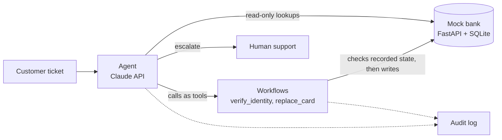

<!-- README.md: the front page of the repo. It says what is built, what is not, and where to look first.
     Why: a reader should see the Phase 0 result and its limits before opening any code, and BANKING77
     is CC BY 4.0, which requires the credit at the end of this file.
     Rule: every figure here is pasted from phase0_resolvability/report.md (made by `make report`) or a
     summary.md under results/. Never type a metric by hand. Update this file when a new phase is built. -->

# Fintech support agent

An analysis of which banking support tickets an AI agent could resolve, with an agent and eval harness planned for a **fictional neobank**. Only Phase 0, the ticket analysis, is built so far.

Not affiliated with Lorikeet; the design is inspired by its public writing.

## Start here: the Phase 0 report

**[`phase0_resolvability/report.md`](phase0_resolvability/report.md) is the main thing to check.** It is generated by `make report` and holds:

- how I scored 15 BANKING77 support intents and sorted them into three tiers;
- a before-and-after comparison of two classifier prompts on 800 test queries;
- the most frequent confusions and why I think they happen;
- what AI cannot resolve yet, and the limits of the data.

## Status

| Part | What it is | Status |
|---|---|---|
| Phase 0 | Ticket resolvability report on BANKING77 | **Built** |
| Phase 1 | Mock bank (FastAPI + SQLite) and a prompt-only baseline agent | Not built yet |
| Phase 2 | Identity verification and card replacement as state machines, agent v1 | Not built yet |
| Phase 3 | Eval harness: baseline against gated agent | Not built yet |
| Phase 4 | Red-team write-up | Not built yet |
| Phase 5 | Demo, deployment plan, discovery questions | Not built yet |

`make eval` and `make bank` are placeholders that print "not built yet".

## Headline results (Phase 0)

Pasted from [`phase0_resolvability/report.md`](phase0_resolvability/report.md). Both runs are on the TEST slice. Prompt v2 was only run on the DEV slice, so the comparison is v1 against v3.

- Before: `20261101T084927Z_v1_test` (prompt v1, TEST slice, 800 queries)
- After: `20261101T103105Z_v3_test` (prompt v3, TEST slice, 800 queries)

| Metric | Before | After | Change |
|---|---|---|---|
| Intent accuracy, in-scope queries | 564 of 600 (94.0%) | 579 of 600 (96.5%) | +2.5 pp |
| Out-of-scope queries correctly labelled `other` | 154 of 200 (77.0%) | 171 of 200 (85.5%) | +8.5 pp |
| Tier accuracy, all queries | 720 of 800 (90.0%) | 753 of 800 (94.1%) | +4.1 pp |

Tier accuracy counts a query as correct when the tier of its gold label equals the tier of its predicted label, so a wrong intent inside the right tier still counts. It covers all 800 queries, and `other` has the tier `none`.

## Phase 0 summary

**The question.** Which of a bank's support tickets could an AI agent resolve end to end, which need a gated workflow, and which should go to a human?

**Scoring.** I scored 15 BANKING77 intents from 1 to 3 on five factors: data or API access, action clarity, policy clarity, risk and ambiguity. A 3 always means better for a bot, so risk 3 is low risk. The scores are my judgement, not measurements. The tier rule is in [`phase0_resolvability/intents.yaml`](phase0_resolvability/intents.yaml):

- **Tier A:** no score is 1. The agent can resolve the ticket end to end with no human oversight.
- **Tier B:** everything else. The agent can resolve it with some human assistance or oversight.
- **Tier C:** two or more scores are 1. The agent needs a human in the loop.

| Tier | Intents |
|---|---|
| A | `activate_my_card`, `order_physical_card`, `edit_personal_details` |
| B | `lost_or_stolen_card`, `passcode_forgotten`, `card_arrival`, `pin_blocked`, `change_pin`, `age_limit`, `declined_card_payment`, `cancel_transfer`, `terminate_account` |
| C | `card_swallowed`, `transaction_charged_twice`, `request_refund` |

The full scores and a written reason for each intent are in the report.

**Classifier.** Claude Haiku 5.5 with structured outputs picks one of the 15 intents or `other`. The model ID and the prompt's SHA-256 are recorded in every `summary.md`. The three prompts are in [`phase0_resolvability/prompts/`](phase0_resolvability/prompts/): v1 lists the intent names only, v2 adds a one-line definition per intent, and v3 changes one line of v2 (`order_physical_card`).

**Data.** Prompts are developed on a DEV slice drawn from the BANKING77 train split. The TEST slice comes from the test split and is used for the headline numbers only. It holds every test query for the 15 intents (600) plus 200 random queries from the other 62 intents, labelled `other`. The sampler uses seed 42 and a test checks that the slices do not overlap.

## Limits

- BANKING77 is a curated, balanced dataset, so its intent mix is not real traffic and no volume figure here is a measurement.
- Gold labels are intents, not tiers; tier accuracy inherits each intent's tier from my scoring.
- Each prompt was run once, so there are no repeat runs or confidence intervals, and a few queries out of 40 per intent is a small sample.
- Phase 0 tested no agent. Classifying a ticket correctly is not the same as resolving it.
- Real tickets are likely messier than BANKING77's one-intent queries, so I expect real-world accuracy to be lower than the figures above. These runs do not measure that.

## How to run

Needs Python 3.12 or newer, [uv](https://docs.astral.sh/uv/) and `make`. On Windows, run them inside WSL (Ubuntu); they are not on the Windows PATH.

```bash
make test
```

```bash
make lint
```

```bash
make report
```

`make report` re-scores the two saved runs under `results/phase0/`, compares them and rewrites `phase0_resolvability/report.md`. It makes no API call. Edit the commentary in `phase0_resolvability/report_template.md`, never in `report.md`.

To redo the whole analysis from the dataset, which spends Anthropic API credit:

```bash
uv run python phase0_resolvability/load_data.py
```

```bash
uv run python -m phase0_resolvability.sample
```

```bash
uv run python -m phase0_resolvability.classify data/slices/test.csv --prompt phase0_resolvability/prompts/v3.txt
```

```bash
uv run python -m phase0_resolvability.evaluate --latest
```

**Environment variables.** Copy `.env.example` to `.env` and fill in the values; `.env` is gitignored and only `config.py` reads it. The names are `ANTHROPIC_API_KEY` (used by the classifier), and `BANK_API_KEY` and `BANK_ENV` (reserved for the mock bank, which is not built yet).

## Planned: the agent, eval and red-team (not built yet)

This is the design I am building towards. None of it exists in the repo yet, and no result below is a measurement.



The rule behind it: the model never calls a write endpoint directly. Writes happen only inside deterministic workflows that check preconditions against recorded bank state, never against what the model or the customer claims. The one exception is a deliberately naive baseline agent, used only against the synthetic bank, so the eval can show what the gating changes.

| Phase | Planned deliverable |
|---|---|
| 1 | FastAPI mock bank with API-key auth and synthetic customers; a hand-written tool-use loop; a prompt-only baseline agent and an audit log |
| 2 | `verify_identity` and `replace_card` as table-tested state machines; a cost-of-mistake table for each operation |
| 3 | About 30 single-turn tickets graded on the bank's end state, baseline against the gated agent, a check of the Phase 0 tiers against what the agent actually did, and `make eval` |
| 4 | A one-page threat model and a set of attack tickets labelled with the OWASP Top 10 for LLM Applications |
| 5 | A 2-minute demo, a half-page deployment plan for a fictional neobank, and five discovery questions |

Deferred until after those: a webhook receiver with signature checks and de-duplication, simulated multi-turn customers, an LLM judge for tone, a second fictional customer, and a generic workflow engine.

## Data handling and credits

- The only external data is BANKING77, a public dataset. The repo holds no customer or personal data.
- Raw dataset files, slices and the classifier's response cache live under `data/`, which git ignores except for `data/README.md`.
- API keys live in `.env` (gitignored), are read in code only and never appear in prompts, logs or results. `.env.example` holds variable names only.
- Phase 0 sends BANKING77 query text and the prompt to the Anthropic API for classification. It sends nothing else.
- The planned mock bank will use synthetic data only: fictional names, `example.com` emails, and the last four digits of a card plus a token.
- Every result file records the model ID and the prompt's SHA-256, so a figure can be traced to the run that produced it.

**Dataset credit.** BANKING77 (PolyAI) is licensed CC BY 4.0. Cite Casanueva et al. (2020), "Efficient Intent Detection with Dual Sentence Encoders".
